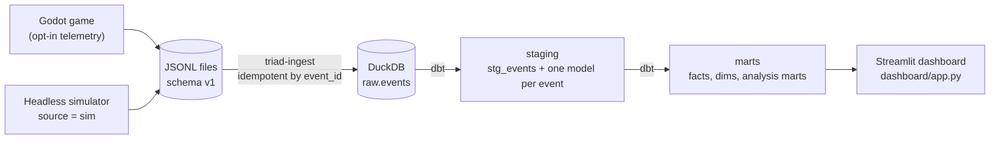

# Triad Protocol analytics

The data pipeline behind the game's balance work. Gameplay telemetry (from human players
who opt in, or from the headless simulator) is loaded into DuckDB and modelled with dbt
into tested marts. The marts answer the design questions in
[the event schema](../docs/analytics/event-schema.md#design-questions-this-data-must-answer).



## Run it

You need [uv](https://docs.astral.sh/uv/). Run the commands from `analytics/`.

```sh
uv sync          # Python 3.13 venv with duckdb, dbt-core, dbt-duckdb, pytest, ruff
make sample      # ingest data/sample/*.jsonl, then dbt build (seeds, models, all tests)
make test        # pytest: ingest idempotency and marts vs. counts taken from the raw JSONL
make full        # same as sample, on the 500-run baselines in data/raw/sim (git-ignored)
make lint        # ruff check + format check
make dashboard   # Streamlit on http://localhost:8501 (full warehouse if built, else the sample)
make docs        # dbt docs generate (then: uv run dbt docs serve --project-dir dbt --profiles-dir dbt)
```

The sample goes to `warehouse/sample.duckdb` and the baselines to `warehouse/triad.duckdb`.
They are separate because both hold a greedy seed-1 run with different ids, so loading
them together would count that run twice. `TRIAD_DUCKDB_PATH` tells dbt which file to use.
To regenerate the baselines, see [the simulator doc](../docs/analytics/simulator.md).

Ingest on its own:

```sh
uv run triad-ingest --input 'data/raw/sim/*.jsonl' --db warehouse/triad.duckdb
```

## Layers

| Layer | Schema | Materialized | What it does |
|---|---|---|---|
| Raw | `raw` | table (append-only) | One row per JSONL line. Envelope columns are read explicitly, `payload` stays JSON, plus `_source_file` and `_loaded_at`. |
| Staging | `staging` | view | Typed envelope, de-duplicated, timestamps cast. One model per event type that unpacks the payload. |
| Reference | `reference` | seed | `battler_roster`: hero and enemy labels copied from `resources/*.tres`. |
| Marts | `marts` | table | Facts, a dimension and two analysis marts. |

## Models

| Model | Grain | Answers |
|---|---|---|
| `stg_events` | one event (`event_id`) | the base of every other model |
| `stg_mission_start`, `stg_mission_end` | one run | mission funnel ends |
| `stg_floor_reached` | one floor reached | funnel steps |
| `stg_battle_start`, `stg_battle_end` | one battle | lineup, HP, outcome |
| `stg_turn_start` | one turn | pacing, energy |
| `stg_actions` | one resolved hit | damage, crits, shields |
| `stg_battler_down` | one battler falling | deaths |
| `fct_battles` | one battle (`battle_id`) | win rate, turns, HP lost |
| `fct_battle_participants` | one battler in a battle (`battle_id`, `battler_id`) | who fell, when, killed by what |
| `dim_battlers` | one battler type (hero id or enemy archetype) | side, role, appearances |
| `fct_actions` | one hit (`battle_id`, `action_seq`, `hit_index`) | damage share is a plain `sum(damage)` |
| `fct_mission_funnel` | one run (`run_id`) | started, floors 1/2/3 reached, result |
| `mart_hero_performance` | policy x hero | damage share, damage per action, crit rate, death rate |
| `mart_floor_difficulty` | policy x floor | battles, win rate, mean turns, party HP lost % |

Human data has no `policy`, so the marts label it `player`. That lets simulator policies
and real players sit side by side in the same chart.

## Data quality

`make sample` runs every check, and so does CI (`.github/workflows/analytics.yml`). They
follow the data-quality rules in the event schema:

- **Keys:** `unique` and `not_null` on every primary key. `unique_combination` checks the
  composite grains (`fct_actions`, `fct_battle_participants`, both analysis marts).
- **Enums:** `accepted_values` on `event_name`, `schema_version`, `source`, `policy`,
  battle and mission `result`, `side` and `hit_kind`.
- **Relationships:** actions and participants link to `fct_battles`, participants link to
  `dim_battlers`, and every mission end has a mission start.
- **Impossible values:** generic tests in `dbt/tests/generic/`. `not_negative` covers
  damage, HP, energy and shield. `lte_column` checks `target_hp_after <= target_hp_before`
  and `wins <= battles`. `in_range` keeps every rate in [0, 1] and turns at 1 or more.
- **Contract rules** (singular tests in `dbt/tests/`):
  - every `battle_start` has exactly one `battle_end`
  - `is_kill` matches the HP values
  - energy is only charged on `hit_index = 0`
  - sim and player rows never share a session
  - damage shares add up to 1
  - the funnel's highest floor matches `mission_end`
- **Dashboard** (`tests/`, pytest): every query matches the marts it reads, and the app
  renders without an exception.
- **Pipeline correctness** (`tests/`, pytest): re-running ingest adds no rows. The marts
  also match counts computed in plain Python straight from the JSONL: battles, wins per
  floor, damage and deaths per hero, mission results.

## Dashboard

`make dashboard` starts the dashboard. The sidebar picks the warehouse:
`TRIAD_DUCKDB_PATH` if set, else `warehouse/triad.duckdb`, else `warehouse/sample.duckdb`.
It also picks which policies to show. The data is read on a short-lived read-only
connection, so `make full` can rebuild the warehouse while the dashboard is open; the
next page load picks up the new numbers.

The plan's anti-goal is a dashboard of vanity charts, so each section answers one balance
question and says what it shows:

| Section | Question | Data |
|---|---|---|
| Header | How does each policy do overall? | missions completed %, battles, mean turns, party crit rate against the designed 15% (`BattleManager.CRIT_CHANCE`) |
| Where do runs fail? | At which step of the mission do runs end? | `fct_mission_funnel`: started, floor 1/2/3, completed |
| Which floor is hard? | Is any floor a wall? | `mart_floor_difficulty`: win rate and party HP lost % per floor |
| Who carries and who dies? | Is one hero carrying, is one fragile? | `mart_hero_performance`: damage share against death rate |
| Do abilities matter? | What do the kits add over basic attacks? | `fct_actions`: usage mix, damage per use, energy per use |
| Findings | What should the designer look at? | sentences computed from the queries, not written by hand |

Colours are fixed across charts: one colour per policy (greedy is the game's cyan
`#00D9E6`), red-amber `#FF6B52` for losses and deaths, yellow `#FFD23F` for energy. The
theme is in `.streamlit/config.toml`, which also turns off Streamlit's usage statistics.

All SQL lives in `src/triad_analytics/queries.py` as functions that take a DuckDB
connection and return a pandas DataFrame. `findings_from` is a pure function of those
frames, so a Phase 6 rebalance shows up as changed Findings with no code change.
`tests/test_queries.py` checks the queries against the marts, and `tests/test_dashboard.py`
runs the whole app headless with Streamlit's `AppTest`.

## Layout

```text
analytics/
├── pyproject.toml, uv.lock, Makefile
├── src/triad_analytics/ingest.py   # triad-ingest CLI
├── src/triad_analytics/queries.py  # dashboard queries + computed findings
├── dashboard/app.py                # Streamlit dashboard (theme in .streamlit/config.toml)
├── dbt/                            # dbt project (profiles.yml included, DuckDB path from env)
│   ├── models/staging/             # stg_* + _staging.yml (source, tests, docs)
│   ├── models/marts/               # fct_*, dim_*, mart_* + _marts.yml
│   ├── seeds/battler_roster.csv
│   ├── macros/generate_schema_name.sql
│   └── tests/                      # singular tests + generic/ tests
├── tests/                          # pytest
└── data/sample/                    # 20-run deterministic sample (committed)
```
